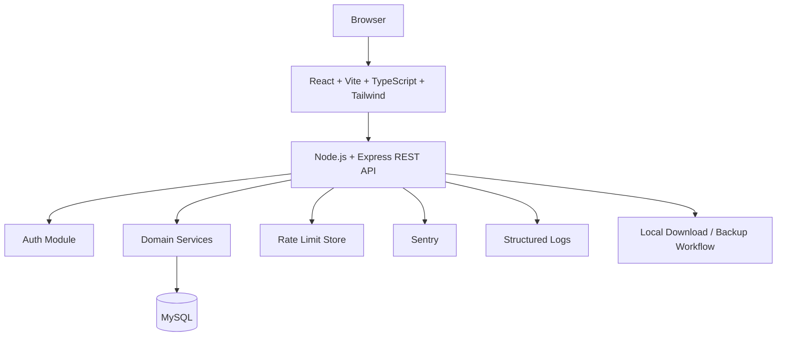

# Architecture

## Decision
Use a **modular monolith**.

### Components


## Modules
- Auth
- Dashboard
- Firms
- Members
- Areas
- Surnames
- Niyari
- Receipts
- Collections
- Reports
- Imports
- Exports
- Backups
- Audit
- Settings

## Folder structure
```text
apps/
  web/
  api/
packages/
  shared/
docs/
prisma/
  schema.prisma
  migrations/
tests/
```

## Backend layering
Routes/controllers -> validation -> authorization -> service/domain logic -> repository/data access -> Prisma/MySQL.

Business logic must not live inside React components or thin route handlers.

## Background work
Use background jobs only where work is long-running (large exports, large imports, report generation, notifications). Keep the first release simple; a queue can be introduced when monitoring shows need.

## Third-party services
- Render: hosting target.
- Sentry: error tracking.
- Email provider: optional.
- Redis-compatible store: rate limiting if needed.

## Three key risks
1. Production MySQL cost versus the ₹0 budget.
2. Family migration semantics and data integrity.
3. Backup/restore correctness for personal data.

## Security boundary
The browser never connects directly to MySQL. Every protected operation goes through the API.
